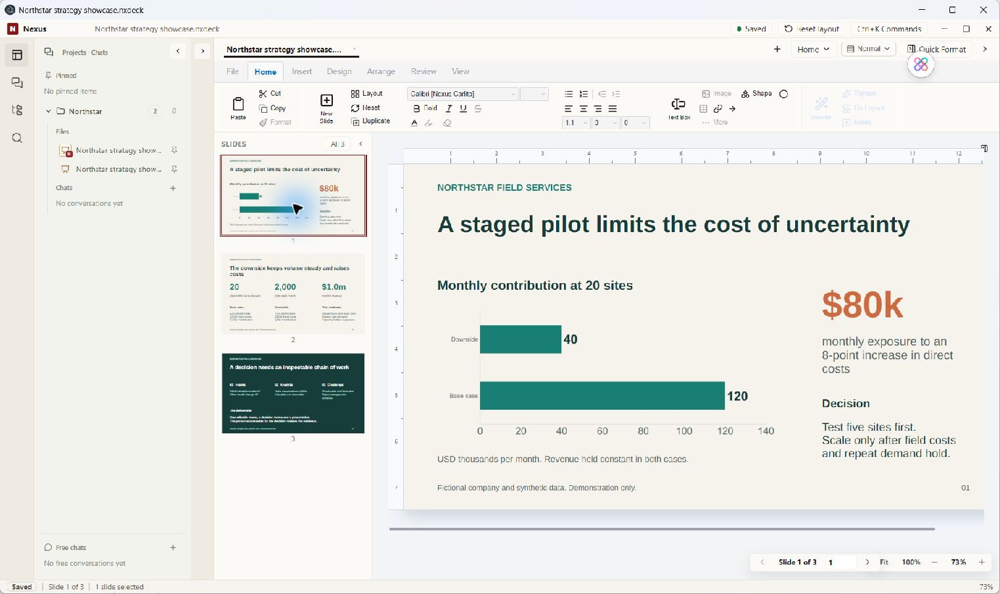
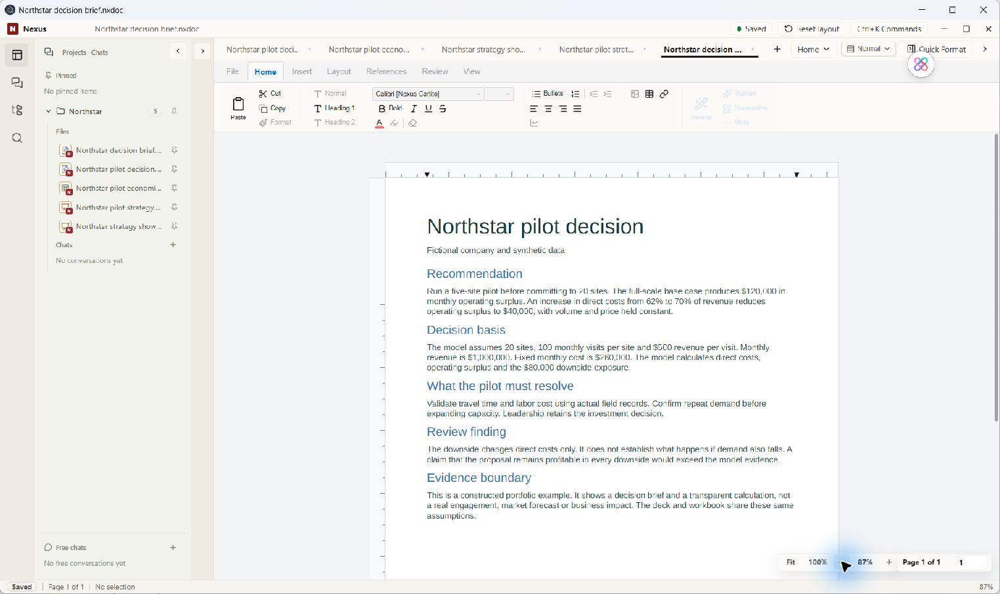
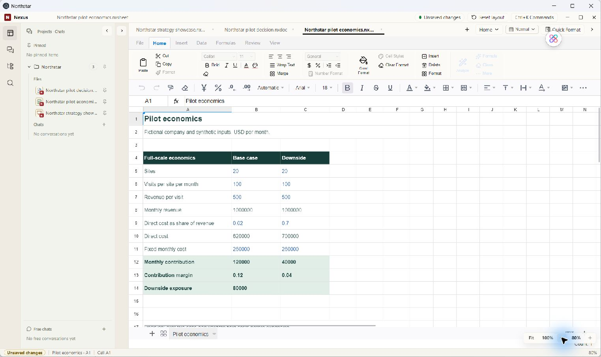

# Nexus: Strategy to Execution With AI

**A private desktop workspace for business strategy · Unshipped R&D · Evidence reviewed October 15, 2026**

Nexus brings presentations, documents, and spreadsheets into one local-first workspace. I’m exploring how business teams could move from assumptions and analysis to a decision, with AI agents helping operate the software. Today, the most concrete product work is making those native editors useful and dependable; the wider connected-work and assistant experience remains incomplete.

I’m **JB Monu, a strategy and operations executive** with a consulting and transformation background. Nexus is my hands-on R&D project: I own the product vision, workflow design, requirements, agent operating model, acceptance standards, and final judgment. **AI coding agents implement most of the software.**

The business problem is familiar: assumptions live in a workbook, reasoning in a memo, and the recommendation in a deck. I want to test a more coherent way to work across them, while learning what it takes to direct AI implementation responsibly.

*Real Nexus window, October 1, 2026: a synthetic business decision in the presentation editor. The input was authored with AI assistance outside Nexus and imported. The capture’s source commit was not established. [Inspect the work sample and downloads](docs/BUSINESS_WORKFLOW_CASE.md).*

## See the product

| A decision memo | Its supporting model |
| --- | --- |
|  |  |

*October 1 app captures using fictional Northstar data. These are separate imported files, with no demonstrated automatic Live Links. The spreadsheet capture does not prove formatting persistence.*

| What has been demonstrated | Evidence and boundary |
| --- | --- |
| PPTX, DOCX, and XLSX inputs displayed in Nexus’s native editors | October 1 captures above; particular files and views, not general Office fidelity |
| Ordinary document-text edits recorded as tracked insertions/deletions, then saved and reopened; supported inline changes exported to DOCX | October 15 independent machine verification; founder acceptance and an actual Word-view check still pending |
| Sampled spreadsheet edits retained across workbook switches, save, and full application reopen | October 15 independent machine verification; post-integration runtime recheck and founder acceptance still pending |

**[See the new October 15 product captures and their limits](docs/PRODUCT_EVIDENCE.md)** · [Full current status](docs/CURRENT_STATUS.md)

## What I contribute

The contribution is moving from an ambiguous priority to a usable capability: choosing the problem, defining the intended experience, coordinating implementation, and judging what the evidence supports. After I approve an outcome, AI orchestration handles routine routing and sequencing. Separate agents build and verify; I retain product decisions and final human judgment.

One standard makes that concrete: content an editor cannot render should still survive save. Complete preservation is a requirement I hold the project to, not a guarantee it has achieved. [My contribution and transferable practice](docs/CASE_STUDY.md).

## One visible loop: review changed the deliverable

A separate reviewer caught an incorrect financial label in the first showcase. The arithmetic deducted fixed costs, so “contribution margin” was the wrong term. The inputs and real Nexus captures were revised to use a defined operating-surplus measure.

The calculation stayed the same; the interpretation changed. I set the brief and review requirements; the separate reviewer found the error and the working agent made the corrections.

[Follow the run and inspect the before-and-after material](docs/RUN_WALKTHROUGH.md).

## Status and further reading

Nexus remains **private, unshipped R&D with no production customers**. Editing coverage, Office export, preservation, performance, and fidelity remain uneven. The October 1 formatting-persistence failure is still recorded; newer spreadsheet checks do not establish that it is fixed. Autonomous in-app generation and cross-artifact Live Links are not demonstrated here.

- [Product evidence](docs/PRODUCT_EVIDENCE.md) and [current status](docs/CURRENT_STATUS.md): what works, how it was checked, and what remains open
- [Case study](docs/CASE_STUDY.md): my contribution and where the practice transfers
- [Run walkthrough](docs/RUN_WALKTHROUGH.md): a real review-and-correction example
- [Working with agents](docs/WORKFLOW.md) and [execution graph](docs/EXECUTION_GRAPH.md): coordination, responsibility, and verification
- [Business work sample and editable downloads](docs/BUSINESS_WORKFLOW_CASE.md) · [Recorded failure](docs/AUDITABLE_RUN_CASE.md)

This is a public companion repository; the product source remains private. Documentation and showcase artifacts were drafted and revised with LLM assistance. I remain responsible for what I publish. For collaboration around business workflows, practical AI adoption, or this R&D project, connect on [LinkedIn](https://www.linkedin.com/in/jb-monu-9a58543).
