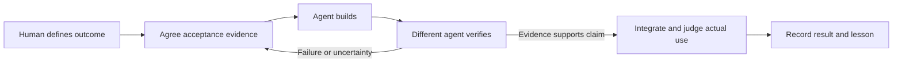

# The Execution Graph: Who Decides and Who Checks

**Operating design · Development workflow, separate from the Nexus product graph**

## What I designed

An execution graph is a map of how a work item moves from intent to an accepted result. It connects responsibility and evidence, so a completion claim can be traced back to what was requested and checked. I design that operating model; AI coding agents perform most implementation work.

After I approve an outcome, the primary orchestrator handles routine routing and sequencing. A bounded build orchestrator handles implementation and retries within the outcome. It cannot redefine the goal, weaken the acceptance standard, or approve its own result.

When direct transport across harnesses is unavailable, I may relay one brief and one return. That is a remaining transport dependency.

## Who decides, what gets checked, and where people remain involved

The operating model separates three kinds of work:

| Part | Responsibility | Boundary |
| --- | --- | --- |
| Agent judgment | Diagnose, break down the approved outcome, select the next useful role, and propose a response to new evidence | An agent cannot redefine the product outcome or approve its own implementation |
| Code-based checks | Validate recorded workflow state and required evidence before a guarded step advances | A valid record does not prove the product works or that the evidence measures the right thing |
| Human judgment | Choose the problem, intended behavior, material scope, and consequential tradeoffs; judge the actual user experience when needed | Routine routing and retries are delegated within the approved outcome |

The agent chooses a proposed next action. The guarded workflow can refuse it when its prerequisites are not met. This is a combination of model judgment and programmatic checks, rather than a claim that every decision is hardcoded or every step is unattended.

The [public run walkthrough](RUN_WALKTHROUGH.md) shows one bounded Codex-assisted review-and-revision cycle. It is separate from the broader Nexus development workflow.

## A simplified map

The [workflow page](WORKFLOW.md) explains how these stages operate. This diagram is an explanation, not a public executable agent system or a trace of an unattended run.

A failed or contradictory result routes to a responsible role. It does not silently redefine success.

## Why it matters

An agent saying “done” is not the same event as independent verification accepting a change. Keeping those stages separate gives the orchestrator a precise next action and gives the human a basis for review.

The October 15 spreadsheet example makes the distinction practical: independent checks supported a bounded repair, while founder acceptance and a post-integration runtime recheck remained open. [Inspect the product evidence](PRODUCT_EVIDENCE.md). Workflow state is useful precisely because those are different events.

## Evidence boundary

This page describes my operating design. It publishes no private code excerpts, internal contract fields, source-version details, or private verification results. It is not a public executable implementation or proof that every run satisfies every intended safeguard.

The development workflow is distinct from the envisioned Nexus product graph linking business workspaces, routines, artifacts, views, and decisions. That in-app system remains incomplete, and the screenshots do not demonstrate it.

[Overview](../README.md) · [Operating workflow](WORKFLOW.md) · [Acceptance example](SUCCESSFUL_RUN_CASE.md)
