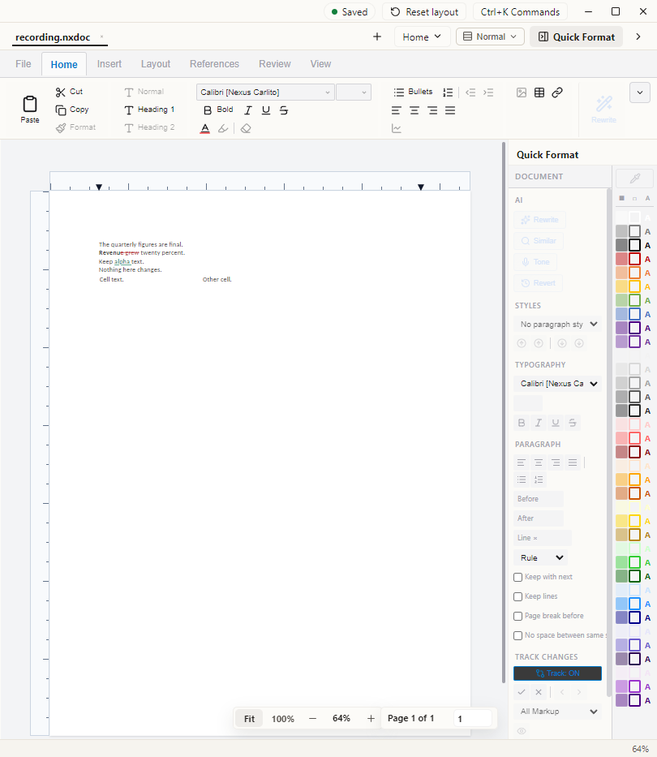
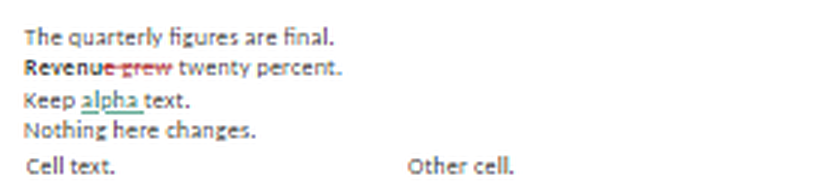
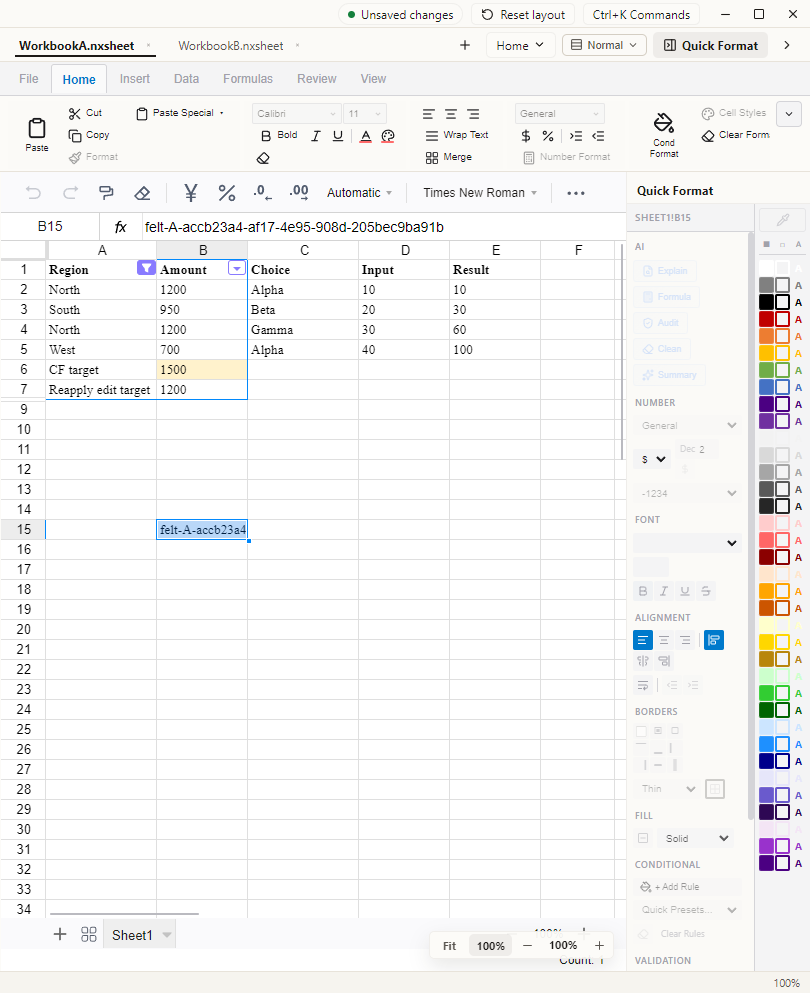
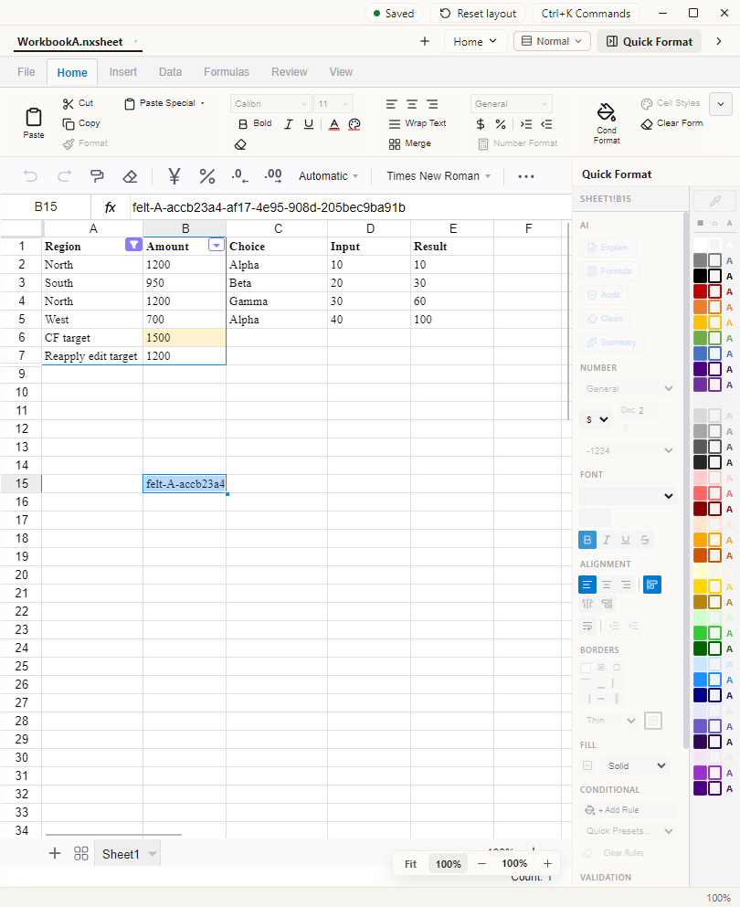

# Nexus in Use: Product Evidence

**October 15, 2026 update · Real application captures · Synthetic demonstration data**

Nexus has native presentation, document, and spreadsheet editors. This page puts particular observed behaviors beside their evidence and limits. The software remains unfinished.

## Document editing: record a change, save, reopen

An independent verification run enabled Track Changes, typed and deleted ordinary body text, saved, fully quit the application, reopened the document, and exported supported inline revisions to DOCX. Separate checks compared the saved and exported text, authorship, dates, and existing revision content.

*Captured October 15 during independent verification. The editor shows synthetic text, a new deletion, an existing fictional author’s insertion, Track ON, and Saved status. The screenshot is a still of the application; the separate executed save/reopen and file checks support persistence.*

*Detail from the same screenshot, enlarged 3× for readability. Document content and revision marks have not been retouched.*

The accepted scope covers ordinary body-text recording, targeted Accept/Reject, Undo/Redo, native save/full reopen, and supported inline revision export. It does not cover every Word editing operation. A tracked paragraph join was saved and reopened natively, but strict DOCX export refused that unsupported structural change. Actual viewing in installed Word and founder acceptance of caret and markup feel remain pending.

## Spreadsheet editing: keep the edit when switching files

A real defect discarded unsaved spreadsheet edits when switching between open workbooks. The repair was independently checked through actual cell entry, tab changes, targeted save, disk reads, and full application restarts.

| Return after switching workbooks | Full reopen after Save |
| --- | --- |
|  |  |

*October 15 captures from the same synthetic test sequence. The unique marker in cell B15 identifies the edit. Left: it remains after returning to workbook A. Right: it remains after Save and a separate cold application reopen. These are two captured states, not a continuous recording or a before/after bug animation.*

The independent verifier passed 21 active feature cases, including a pending cell entry and a two-workbook interrupted-save recovery case. Other checks sampled formulas, formatting, sheet structure, and each workbook saving to its own file. Post-integration runtime rechecking and founder acceptance remain open. The separate October 1 currency/percentage-format failure has not been shown fixed.

## A business workflow across three editors

The existing [Northstar work sample](BUSINESS_WORKFLOW_CASE.md) shows a fictional rollout decision through a model, memo, and presentation. Its October 1 captures remain useful visual evidence of those imported files. Their source build commit was not established, so they are not relabelled as October 15 captures.

The [review-and-revision walkthrough](RUN_WALKTHROUGH.md) also exposes a real before/after correction: a separate reviewer challenged the financial terminology, and the public inputs and captures changed. Neither example demonstrates automatic links or autonomous generation within Nexus.

## Capture provenance and boundaries

| Material | Source and preparation | What can be concluded |
| --- | --- | --- |
| October 15 document images | Retained screenshots from a different-agent verification run against a freshly rebuilt private candidate; the candidate was integrated later that day. The original image was matched to its retained SHA-256 manifest. | The displayed synthetic revision state was present in the real app. Executed checks, not the pixels alone, establish the stated persistence/export results. |
| October 15 spreadsheet images | Retained, versioned screenshots from a different-agent verification run and its full-reopen sequence; the candidate was integrated later that day. Original image bytes were matched to the inspected private integration snapshot. | The same sampled cell edit is visible after switching and after reopening. Broader correctness and founder acceptance do not follow. |
| October 1 Northstar images and downloads | Existing public synthetic showcase, authored outside Nexus and imported into an existing local build | Particular imported views and a bounded review/correction cycle; no latest-build or Nexus-export claim |

The new images are cropped to the editor, excluding project navigation and assistant panels. Apart from cropping and the labelled enlarged detail, no pixels were retouched, no states were composited, and no UI was generated. They contain synthetic test text and values. Raw logs, private paths, implementation code, internal prompts, and complete operating instructions are not included.

No new screen recording was produced for this update. The October 15 captures predate integration; a continuous recording on a known post-integration build remains an evidence gap. [Current status](CURRENT_STATUS.md) retains the failing checks, pending acceptance, and scope limits.

[Overview](../README.md) · [Business work sample and downloads](BUSINESS_WORKFLOW_CASE.md) · [My contribution](CASE_STUDY.md)
